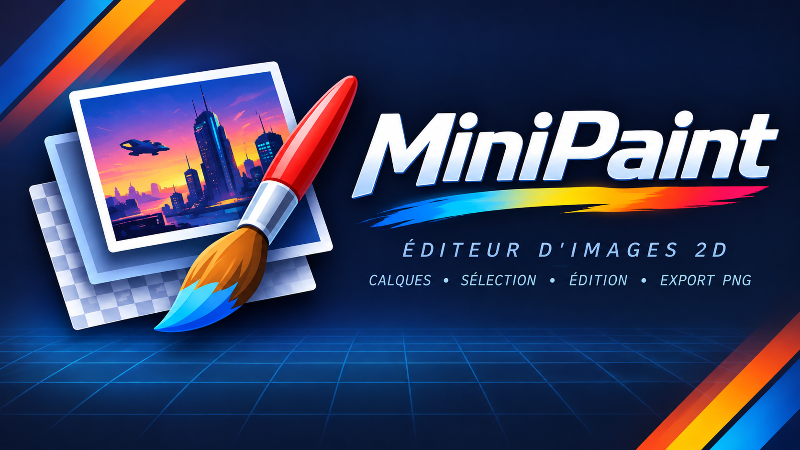

# MiniPaint

<p align="center">
  
</p>

Local Windows 2D image editor — C# / .NET 10, Avalonia UI, SkiaSharp.

**Développé par Cursor, orchestré par Eric Kernin.**

## Requirements

- .NET SDK 10.x (`dotnet --list-sdks`)
- Avalonia project templates (optional, for scaffolding): `dotnet new install Avalonia.Templates`
- Avalonia + SkiaSharp restore via NuGet (no separate system installer)

## Build & run

```powershell
cd d:\MiniPaint
dotnet restore MiniPaint.slnx
dotnet build MiniPaint.slnx
dotnet test
dotnet run --project src\MiniPaint.App
# or: MiniPaint.bat
```

## Publish & pin to the Windows taskbar

Debug `bin\` builds and `.bat` launchers do **not** pin reliably. Use the Release self-contained publish:

```powershell
cd d:\MiniPaint
.\publish.bat
# same as: powershell -File .\scripts\Publish-MiniPaint.ps1
```

| What | Path |
|------|------|
| **Pin this** | `d:\MiniPaint\MiniPaint.lnk` (right-click → Pin to taskbar) |
| Or pin the exe | `d:\MiniPaint\publish\MiniPaint.exe` |
| Published folder | `d:\MiniPaint\publish\` (self-contained win-x64) |

After each meaningful build you want on the taskbar:

```powershell
.\publish.bat
```

That **deletes** `publish\`, increments `build-number.txt`, publishes as version `1.0.<n>`, regenerates `MiniPaint.lnk`, then by default **commits/pushes** the counter to `main` and creates a **GitHub Release** (`v1.0.<n>` + zip under `dist\`).

```powershell
.\publish.bat                 # full: publish + push + Release
.\publish.bat -SkipGit        # local publish only
.\publish.bat -SkipRelease    # publish + push counter, no Release zip
```

The version appears in **Help → About**. `MiniPaint.bat` launches the published exe when present, otherwise falls back to Debug.

## Logs (crashes)

Session logs: `%LocalAppData%\MiniPaint\logs\`  
Last fatal dump: `%LocalAppData%\MiniPaint\logs\crash-last.txt`  

In the app: **Help → Open Log Folder**.

## Features

- **Documents** — multi-tab workspace; open PNG/JPEG/IFF-ILBM; native `.minipaint` ZIP projects (layers preserved); New / Save / Close; drag-and-drop files onto the window to open
- **Export** — merged PNG or JPG (quality 1–100; transparency flattened onto white); IFF-ILBM when the document is in an indexed-family mode (Indexed / ECS / AGA)
- **Export All Images** — every open tab into one folder as PNG or JPG (one JPG quality for all); file names from tab names, numbered instead of overwriting unless asked
- **Layers** — add / delete / duplicate / rename, reorder, visibility, opacity, Photoshop-style blend modes, Move tool; context menu **New Image from Layer Content** (trim to opaque bounds)
- **Selection** — mask-based (any shape, soft edges) with marching ants along the outline; rectangular marquee and **Magic Wand** (W: tolerance, contiguous, anti-alias, sample visible image or current layer — exact palette colors in Indexed / ECS / AGA); New / Add / Subtract / Intersect from the options bar or Shift / Alt / Shift+Alt; **Select** menu: All, Deselect, Inverse (Ctrl+Shift+I), **Color Range** (pick colors from a preview, Shift / Alt to add / remove, fuzziness for soft edges, live black & white preview); move the outline (V) or lift & drag selected pixels with Move (M); copy / cut / paste as new layers across documents; selection changes are undoable
- **Transform Selection** (Ctrl+Alt+T) — resize/move the marquee only (Shift aspect, Alt from center)
- **Free Transform** (Ctrl+T) — scale / rotate / move a layer; with an active selection, lifts the selection content (like Move), transforms the float, then pastes back and updates the marquee; Enter apply · Esc cancel
- **Image Mode** (Ctrl+Shift+M) — live color constraint: **RGBA**, **Indexed**, **ECS** (12-bit / 4096 palette, optional Half-Brite), **AGA** (2–256 colors); quantizers Median Cut, Octree, Wu, K-Means++, NeuQuant; dither None / Floyd–Steinberg / Bayer 4×4 & 8×8 / Atkinson / Stucki / Blue Noise; Preview toggle; OK commits undoably
- **Palette editor** (Ctrl+Shift+P) — edit indexed palettes; ECS uses 0–15 nibbles with read-only EHB mirrors
- **Image Size** (Ctrl+Alt+I) / **Canvas Size** (Ctrl+Alt+C) — scale pixels (Skia) or crop/extend with 9-point anchor
- **Resize All Images** — scale every open tab by percentage, to fit within W×H (optionally never enlarging) or to an exact size, with a before → after preview; one undo step per tab
- **View** — cursor-centered zoom, pan (middle mouse / Space+drag), nearest-neighbor at high zoom, checkerboard, Fit (Ctrl+0), 100% (Ctrl+1)
- **History** — undo / redo (Ctrl+Z / Ctrl+Y), including selection changes; Ctrl+Z during a transform cancels it
- **App** — startup splash with version; About credits; session logs under `%LocalAppData%\MiniPaint\logs\` (Help → Open Log Folder); Release publish via `publish.bat` (self-contained win-x64, taskbar pin, optional GitHub Release)

## Solution layout

- `src/MiniPaint.Core` — document model, composition, selection, transform, color modes, clipboard, history, PNG / JPG / IFF / project I/O, batch resize & export
- `src/MiniPaint.App` — Avalonia editor UI, splash, toolbox icons, dialogs
- `tests/MiniPaint.Core.Tests` — pixels, composition, transform, selection, color modes, serialization

## Credits

Développé par Cursor, orchestré par Eric Kernin.

## License

MIT — Copyright (c) 2026 Éric Kernin / ErkMkd. See [LICENSE](LICENSE).
